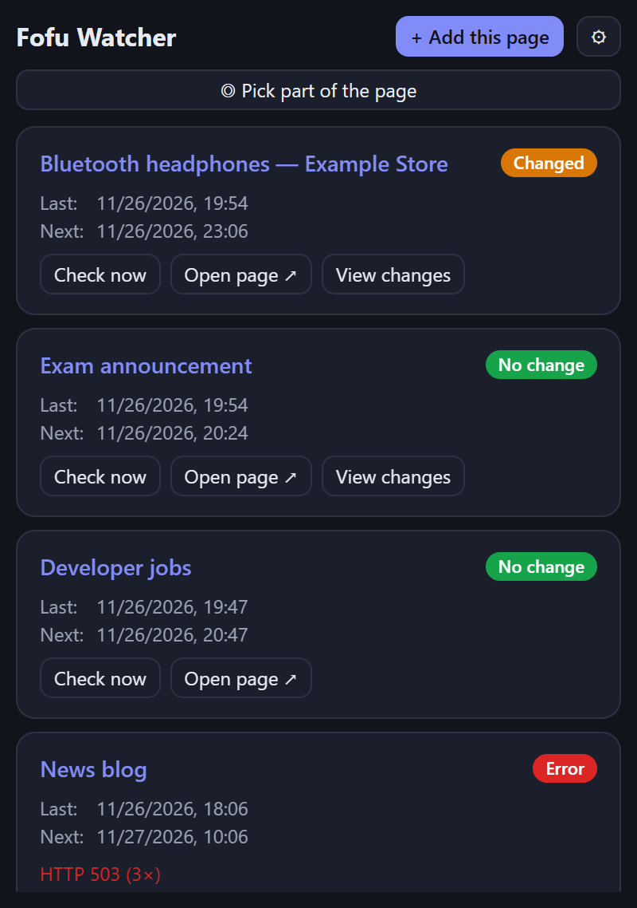
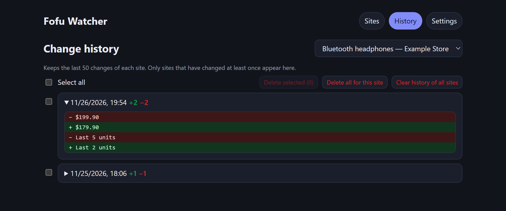
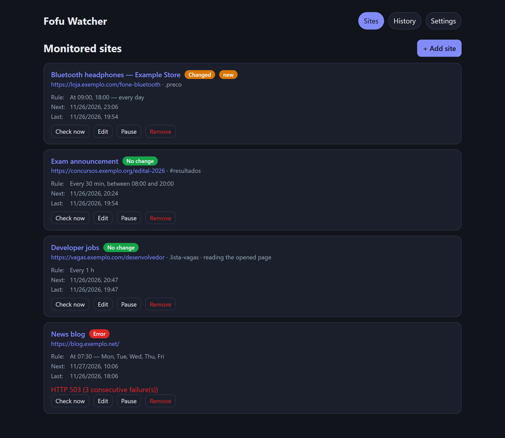

# Fofu Watcher

[🇧🇷 Português](README.md) · 🇺🇸 English

A Manifest V3 extension for **Google Chrome and Brave** that monitors websites and notifies you when their content changes.
Everything runs locally: no external server, no telemetry.

<p align="center">
  
  
</p>
<p align="center">
  
</p>

<sub>The sites in the screenshots are fictional examples.</sub>

## Installation (developer mode)

Requirements: Git and Node.js 20+ (only to build; developed with Node 24).

```bash
git clone https://github.com/TiuCadu/fofu-watcher.git
cd fofu-watcher
npm install
npm run build      # generates the dist/ folder
```

**Chrome**
1. Open `chrome://extensions`.
2. Turn on **Developer mode** (top-right corner).
3. Click **Load unpacked** and select the `dist/` folder.
4. Pin the icon to the toolbar (puzzle-piece menu) to see the badge.

**Brave**
1. Open `brave://extensions`.
2. Turn on **Developer mode**.
3. Click **Load unpacked** and select the `dist/` folder.
4. In Brave, check *Settings → System/Notifications* and your Windows/macOS notification settings so Brave can show alerts.

After changing the code: `npm run build` and click **Reload** (↻) on the extensions page.

## Repository and workflow

- **GitHub:** [TiuCadu/fofu-watcher](https://github.com/TiuCadu/fofu-watcher). The main branch is `main`.
- **Commits:** message in Portuguese, in the present tense (`Adiciona …`, `Corrige …`), with the version in parentheses when there is one (e.g. `Corrige … (v1.6.2)`). User-visible changes go in the [CHANGELOG](CHANGELOG.md).
- **Line endings:** `.gitattributes` enforces LF for every file, including on Windows.
- **Not versioned:** `node_modules/`, `dist/` (generated by the build) and `.llm/` (local drafts).

## How to use

- **Add the open page:** click the icon → **+ Add this page** (URL and title come pre-filled). If the extension options page is already open, it is reused (no new tab).
- **Add manually:** icon → ⚙ → **Add site**.
- **Check now:** the button shows the result right away (first reading saved as baseline, no changes, it changed, or the error). Remember: the first check never notifies.
- **Go to the monitored page:** in the popup and in the site list, the site name is a link (the popup also has an **Open page ↗** button); click to open the page in a new tab.
- **Monitor only part of a page:** see “Pick the part of the page” below.
- When saving, the browser asks for access **to that site only** (`optional_host_permissions`).
- The first check only stores the baseline version, without notifying.
- **Scheduling** (per site):
  - *Fixed times*: a list of times and, optionally, weekdays.
  - *Interval*: every N minutes/hours, with an optional window (e.g. 8:00 AM–8:00 PM).
  - The rule summary and the next check are shown in the form, the popup and the list.
- Clicking the notification (or **View changes**) opens the diff page: green = added, red = removed.
- Options: language, time format, sound, "Do not disturb", history (last 50 changes per site), JSON export/import.

### Change history

Under **Options → History**:

- Only sites that **have changed at least once** are listed. Sites with no recorded change yet (just added, or never changed) do not appear.
- Each change has a checkbox. Tick the ones you want and click **Delete selected**; **Select all** ticks/unticks everything for the site.
- **Delete all for this site** removes the whole history of the chosen site; **Clear history of all sites** removes it for every site.
- You are always asked to confirm, and it cannot be undone.
- Deleting history does **not** stop monitoring or change the baseline: the site keeps being checked and the next change shows up again. If a site's history becomes empty, its "unseen" mark (badge) goes away.

### Pick the part of the page (no CSS needed)

By default the whole page is monitored, which triggers alerts for changes that do not matter (ads, clocks…). To monitor only a part (e.g. the price):

1. With the page open, click the icon → **◎ Pick part of the page**.
2. Move the mouse: the element under the cursor is highlighted. **Click** what you want to monitor (↑ selects the parent element; Esc cancels).
3. The form opens pre-filled, showing what you picked. Use **Test** to see the text the extension actually sees in that part.
4. When saving, the extension checks the part against the HTML it receives and warns if it finds nothing (see the limitation below).

You can also use **Pick on the page** inside the form (it opens the site in a tab). The CSS selector remains editable under **Advanced**. The selector prefers `id` and stable attributes (`data-testid`…) and avoids auto-generated or state classes.

### Sites that ask for login or build the page with JavaScript (e.g. Mercado Livre)

By default the extension downloads the site's raw HTML (`fetch`), which is light and fast. Some sites do not work that way:

- **They ask automated requests to log in/verify.** Mercado Livre, for example, replaces the product page with "Hello! To continue, sign in to your account" (`/gz/account-verification`). The extension now says so clearly ("the site asked for login/verification") instead of "selector not found".
- **They build their content with JavaScript** (prices, lists, news): the raw HTML has no text.

For those sites, edit the site and tick **Read by opening the page**. On every check the extension:

1. opens the site in a **minimized window** (using your browser's cookies and login, and running the page's JavaScript);
2. waits for it to load and for the part to appear and stop changing (up to ~10 s);
3. reads the visible text of the part (or the whole page) and **closes the window** — always, even on errors.

Tips:
- If the site asks you to log in, sign in normally in the browser; the minimized window uses the same session.
- Use **Test** after ticking the option: it reads the same way monitoring does.
- It is heavier than the default mode and a window may briefly show in the taskbar: prefer intervals of **15 min or more** (this also keeps the site from blocking frequent visits).
- With this option the visual picker is fully consistent: what you pick on the rendered page is exactly what the extension reads.
- Switching the read mode restarts the baseline (the read text changes format).

#### Notices that hide the content (age, cookies)

Some sites show a notice before the page — e.g. **"Are you over 18? Yes / No"** (stores such as Vendizap ones) or a cookie banner — and only build the product/price after you answer. With **Read by opening the page** ticked, the field **Before reading, click the button with the text** appears:

- Type the exact button text (e.g. `Sim`, `Accept`); case and spaces do not matter.
- On every check the extension waits for the button, clicks it **once** and only then reads the part. Invisible buttons are ignored.
- If the button does not appear (the site remembered the answer, or the part is already on screen), it reads normally, without an error.
- You configure the text: the extension only clicks what you typed, on the site you configured.

### Language and time format

Under **Options → Settings**:

- **Language:** *Follow browser* (default), *Português (Brasil)* or *English (US)*. English browser → English; Portuguese or any other language → Portuguese.
- **Time format:** *Automatic* (default: 24h for Portuguese, 12h for English), *24-hour* or *12-hour*. It is **independent of the language**: you can run the English UI with 24h, or the Portuguese UI with 12h.
- Changes apply **immediately** in the popup, options, history, diff and upcoming notifications — no reload or reinstall.
- The format affects: fixed schedule times (e.g. `18:00` or `6:00 PM`), the interval-mode window, "Do not disturb", last/next check and history dates.
- Times are **always stored in 24h** (`"HH:mm"`) in `chrome.storage.local`; conversion is display-only, so switching between 12h and 24h never corrupts existing schedules.
- Because the native `<input type="time">` follows the OS language and cannot be forced to 12h/24h, the extension ships its own time picker (hour, minute and AM/PM in 12h mode).

## Architecture

```
src/background  service worker: "tick" alarm, notifications, badge  | checker.ts: fetch→offscreen→hash→diff
src/offscreen   DOMParser: strips script/style/comments, applies the CSS selector, extracts text
src/popup       site list, status, "Check now", "Pick part of the page"
src/picker      visual picker (injected into the page on demand)
src/options     sites, schedule, history, settings, backup
src/diff        page opened from the notification
src/utils       storage, time/schedule/formatting (time.ts), i18n (i18n.ts), time picker, normalization, diff, hash, permissions, UI helpers
_locales/       pt_BR and en_US dictionaries (messages.json) — single source of every string
```

### Internationalization

- **No hardcoded text in code:** everything comes from keys in `_locales/pt_BR/messages.json` and `_locales/en_US/messages.json`. HTML uses `data-i18n` (plus `data-i18n-placeholder` / `-title` / `-aria-label`); TypeScript uses `t('key', { param })`.
- **`chrome.i18n`** (with `default_locale: pt_BR` in the manifest) translates the extension **name and description** (including in the store), following the browser language. It does not allow manual switching.
- **Own layer** (`src/utils/i18n.ts`): reads the **same** `messages.json` files according to the preference saved in storage, which allows switching language inside the extension. Error messages are stored as `{ key, params }` and translated only when displayed, so they also switch language live.
- Dates and times use `Intl.DateTimeFormat` with the chosen locale (`pt-BR`/`en-US`) and hour cycle (12h/24h).
- **Adding a string/language:** add the key to both `messages.json` files.

- **Scheduling:** each site stores its own `nextRun`. A single 1-minute `chrome.alarms` wakes the service worker, which checks the overdue sites. The alarm is recreated on `onInstalled`, `onStartup` and on every worker wake-up. If the browser was closed at the scheduled time, the overdue `nextRun` triggers a late check on startup.
- **Detection:** normalized text (whitespace/line breaks) → SHA-256 → comparison with the previous hash.
- **Errors:** failures (site down, 30 s timeout, 403, 404…) never delete the baseline; you are alerted after 3 consecutive failures.

### Permissions
`storage`, `alarms`, `notifications`, `offscreen`, `activeTab` and `scripting`. For sites with **Read by opening the page**, `scripting` also reads the text of the minimized window the extension opens (with that site's permission). `activeTab` reads the current tab's URL/title when you click "Add this page"; together, `activeTab` and `scripting` inject the visual picker **only** into the tab where you click "Pick part of the page" (nothing is ever injected into sites automatically). Site access: only registered sites, on demand.

## Known limitations

- Sites that render everything with JavaScript (SPAs) or ask for login/verification do not work in the default mode (`fetch`); use **Read by opening the page**. That mode is slower, opens a minimized window and depends on the site not blocking frequent visits; sites with a captcha on every visit still do not work.
- Checks only run while the browser is open (late ones run on startup) and the effective minimum interval is ~1 minute.
- Sites with anti-bot/captcha protection or special header requirements may answer 403.
- The visual picker sees the fully rendered page, but the extension fetches the raw HTML (`fetch`). On sites that build content with JavaScript, the picked part may not exist in the raw HTML; the test on save warns you, but monitoring those sites may not work.
- The visual picker does not work on browser-internal pages (`chrome://`, `brave://`), the extension store, and some PDF viewers.
- A wrong CSS selector or dynamic content (ads, recommendations) causes false positives; use the selector and the volatile-content option. Volatile detection is heuristic and may hide real changes in dates/times/numbers followed by "hours", "visits", etc.
- `chrome.storage.local` quota (~10 MB): very large pages store the whole baseline; history keeps at most 300 diff lines per change.
- After importing a backup you must grant the site permissions again (browser requirement).
- The diff is line-based, with no intra-line highlighting; for huge pages it falls back to a set comparison (no ordering).
- Notifications depend on OS settings (the OS Focus/Do-not-disturb mode also silences them).
- Only Portuguese (Brazil) and English (US) are provided; the extension name/description shown by the browser/store falls back to Portuguese for other browser languages.
- The date order follows the chosen locale (e.g. `04/03/2026` in pt-BR vs `03/04/2026` in en-US).

## License

[MIT](LICENSE): free to use, copy, modify and distribute, as long as the copyright notice is kept.
