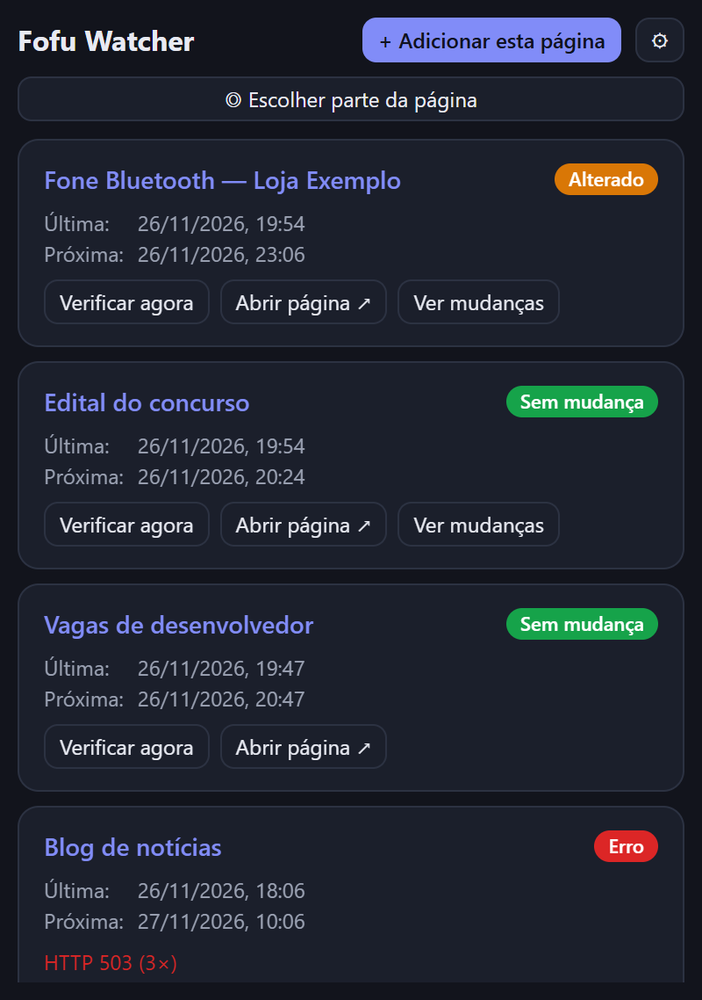
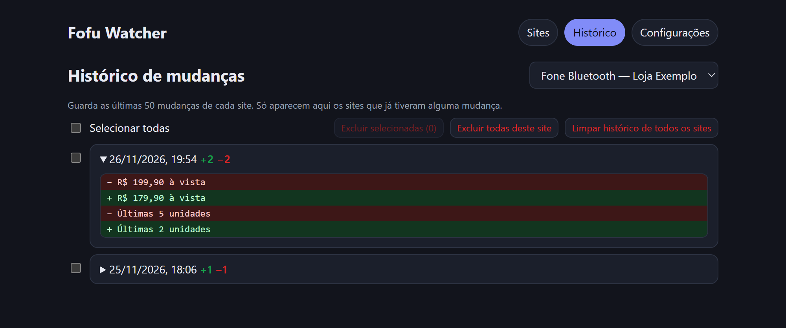
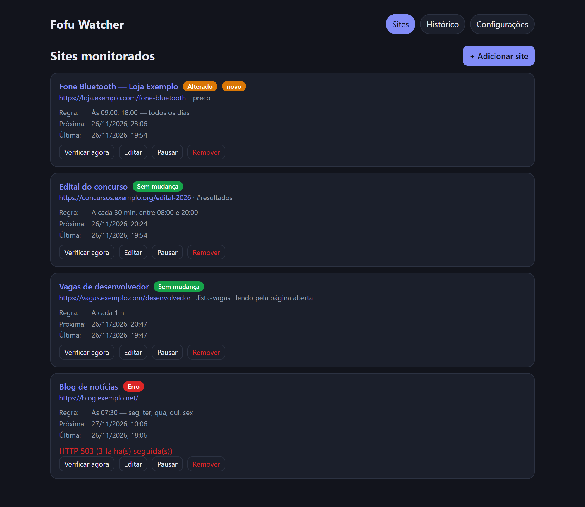

# Fofu Watcher

🇧🇷 Português · [🇺🇸 English](README.en.md)

Extensão (Manifest V3) para **Google Chrome e Brave** que monitora sites e avisa quando o conteúdo muda.
Tudo roda localmente: sem servidor externo, sem telemetria.

<p align="center">
  
  
</p>
<p align="center">
  
</p>

<sub>Os sites dos prints são exemplos fictícios.</sub>

## Instalação (modo desenvolvedor)

Requisitos: Git e Node.js 20+ (só para compilar; desenvolvido com o Node 24).

```bash
git clone https://github.com/TiuCadu/fofu-watcher.git
cd fofu-watcher
npm install
npm run build      # gera a pasta dist/
```

**Chrome**
1. Abra `chrome://extensions`.
2. Ative **Modo do desenvolvedor** (canto superior direito).
3. Clique em **Carregar sem compactação** e selecione a pasta `dist/`.
4. Fixe o ícone na barra (menu de quebra-cabeça) para ver o badge.

**Brave**
1. Abra `brave://extensions`.
2. Ative **Modo do desenvolvedor**.
3. Clique em **Carregar sem compactação** e selecione a pasta `dist/`.
4. Em Brave, confira em *Configurações → Sistema/Notificações* e nas notificações do Windows/macOS que o Brave pode exibir avisos.

Depois de alterar o código: `npm run build` e clique em **Recarregar** (↻) na página de extensões.

## Repositório e fluxo de trabalho

- **GitHub:** [TiuCadu/fofu-watcher](https://github.com/TiuCadu/fofu-watcher). A branch principal é a `main`.
- **Commits:** mensagem em português, no presente (`Adiciona …`, `Corrige …`), com a versão entre parênteses quando houver (ex.: `Corrige … (v1.6.2)`). Mudanças visíveis ao usuário entram no [CHANGELOG](CHANGELOG.md).
- **Finais de linha:** o `.gitattributes` fixa LF em todos os arquivos, inclusive no Windows.
- **Não versionados:** `node_modules/`, `dist/` (gerado pelo build) e `.llm/` (rascunhos locais).

## Como usar

- **Adicionar uma página aberta:** clique no ícone → **+ Adicionar esta página** (a URL e o título já vêm preenchidos). Se a página de opções da extensão já estiver aberta, ela é reaproveitada (não abre outra aba).
- **Adicionar manualmente:** ícone → ⚙ → **Adicionar site**.
- **Verificar agora:** o botão mostra o resultado na hora (primeira leitura guardada como base, sem mudanças, houve mudança ou o erro). Lembre: a primeira verificação nunca notifica.
- **Ir para a página monitorada:** no popup e na lista de sites, o nome do site é um link (e há o botão **Abrir página ↗** no popup); clique para abrir a página numa nova aba.
- **Monitorar só uma parte da página:** veja “Escolher a parte da página” abaixo.
- Ao salvar, o navegador pede permissão de acesso **apenas àquele site** (`optional_host_permissions`).
- A primeira verificação só guarda a versão base, sem notificar.
- **Agendamento** (por site):
  - *Horários fixos*: lista de horários e, opcionalmente, dias da semana.
  - *Intervalo*: a cada N minutos/horas, com janela opcional (ex.: 08:00–20:00).
  - O resumo da regra e a próxima verificação aparecem no formulário, no popup e na lista.
- Clicar na notificação (ou em **Ver mudanças**) abre a página de diff: verde = adicionado, vermelho = removido.
- Opções: idioma, formato de hora, som, “Não perturbe”, histórico (50 últimas mudanças por site), exportar/importar JSON.

### Histórico de mudanças

Em **Opções → Histórico**:

- Só aparecem os sites que **já tiveram alguma mudança**. Sites ainda sem mudanças registradas (acabaram de ser cadastrados ou nunca mudaram) não aparecem na lista.
- Cada mudança tem uma caixa de seleção. Marque as que quiser e clique em **Excluir selecionadas**; **Selecionar todas** marca/desmarca tudo do site.
- **Excluir todas deste site** apaga o histórico inteiro do site escolhido; **Limpar histórico de todos os sites** apaga o de todos.
- Sempre há confirmação antes de excluir, e não dá para desfazer.
- Excluir histórico **não** para o monitoramento nem muda a versão base: o site continua sendo verificado e a próxima mudança volta a aparecer. Se o histórico do site ficar vazio, o aviso de "não visto" (badge) daquele site some.

### Escolher a parte da página (sem saber CSS)

Por padrão a página inteira é monitorada, o que gera avisos por mudanças que não importam (anúncios, relógios…). Para monitorar só um trecho (ex.: o preço):

1. Com a página aberta, clique no ícone → **◎ Escolher parte da página**.
2. Passe o mouse: o elemento sob o cursor é destacado. **Clique** no que quer monitorar (↑ escolhe o elemento pai; Esc cancela).
3. O formulário abre já preenchido, mostrando o que você escolheu. Use **Testar** para ver o texto que a extensão realmente enxerga naquele trecho.
4. Ao salvar, a extensão confere o trecho no HTML que ela recebe e avisa se não encontrar nada (veja a limitação abaixo).

Também dá para usar **Escolher na página** dentro do formulário (abre o site numa aba). O seletor CSS continua editável em **Avançado**. O seletor é gerado preferindo `id` e atributos estáveis (`data-testid`…) e evitando classes geradas automaticamente ou de estado.

### Sites que pedem login ou montam a página com JavaScript (ex.: Mercado Livre)

Por padrão a extensão baixa o HTML bruto do site (`fetch`), que é leve e rápido. Alguns sites não funcionam assim:

- **Pedem login/verificação para acessos automáticos.** O Mercado Livre, por exemplo, troca a página do produto por "Olá! Para continuar, acesse sua conta" (`/gz/account-verification`). A extensão agora avisa isso com clareza ("o site pediu login/verificação") em vez de "seletor não encontrado".
- **Montam o conteúdo com JavaScript** (preço, listas, notícias): o HTML bruto vem sem o texto.

Para esses sites, edite o site e marque **Ler abrindo a página**. A cada verificação a extensão:

1. abre o site numa **janela minimizada** (usando os cookies e o login do seu navegador, e rodando o JavaScript da página);
2. espera carregar e o trecho aparecer e parar de mudar (até ~10 s);
3. lê o texto visível do trecho (ou da página inteira) e **fecha a janela** — sempre, mesmo se der erro.

Dicas:
- Se o site pedir login, entre na sua conta normalmente no navegador; a janela minimizada usa a mesma sessão.
- Use **Testar** depois de marcar a opção: ele lê do mesmo jeito que a monitoração.
- É mais pesado que o modo padrão e uma janela pode aparecer rapidamente na barra de tarefas: prefira intervalos de **15 min ou mais** (também evita que o site bloqueie por excesso de acessos).
- Com essa opção, o seletor visual fica totalmente coerente: o que você escolhe na página montada é exatamente o que a extensão lê.
- Trocar o modo de leitura recomeça a versão base (o texto lido muda de formato).

#### Avisos que escondem o conteúdo (idade, cookies)

Alguns sites mostram um aviso antes da página — por exemplo **"Você é maior de 18 anos? Sim / Não"** (lojas como as da Vendizap) ou um banner de cookies — e só montam o produto/preço depois da resposta. Com **Ler abrindo a página** marcado, aparece o campo **Antes de ler, clicar no botão com o texto**:

- Escreva o texto exato do botão (ex.: `Sim`, `Aceitar`); maiúsculas e espaços não importam.
- A cada verificação a extensão espera o botão aparecer, clica nele **uma vez** e só então lê o trecho. Botões invisíveis são ignorados.
- Se o botão não aparecer (o site lembrou a resposta, ou o trecho já está na tela), ela lê normalmente, sem erro.
- Quem configura o texto é você: a extensão só clica no que você escreveu, no site em que você configurou.

### Idioma e formato de hora

Em **Opções → Configurações**:

- **Idioma:** *Seguir o navegador* (padrão), *Português (Brasil)* ou *English (US)*. Navegador em inglês → inglês; português ou qualquer outro idioma → português.
- **Formato de hora:** *Automático* (padrão: 24h em português, 12h em inglês), *24 horas* ou *12 horas*. É **independente do idioma**: dá para usar interface em inglês com 24h, ou em português com 12h.
- A troca vale **na hora** em popup, opções, histórico, diff e nas próximas notificações — sem recarregar nem reinstalar.
- O formato afeta: os horários fixos do agendamento (ex.: `18:00` ou `6:00 PM`), a janela do modo intervalo, o "Não perturbe", a última/próxima verificação e as datas do histórico.
- Os horários são **sempre guardados em 24h** (`"HH:mm"`) no `chrome.storage.local`; a conversão é só visual, então alternar entre 12h e 24h nunca corrompe agendamentos existentes.
- Como o `<input type="time">` nativo segue o idioma do sistema e não permite forçar 12h/24h, a extensão usa um seletor de hora próprio (hora, minuto e AM/PM no modo 12h).

## Arquitetura

```
src/background  service worker: alarm "tick", notificações, badge  | checker.ts: fetch→offscreen→hash→diff
src/offscreen   DOMParser: remove script/style/comentários, aplica o seletor CSS, extrai o texto
src/popup       lista de sites, status, "Verificar agora", "Escolher parte da página"
src/picker      seletor visual (injetado na página sob demanda)
src/options     cadastro, agenda, histórico, configurações, backup
src/diff        página aberta pela notificação
src/utils       storage, tempo/agenda/formatação (time.ts), i18n (i18n.ts), seletor de hora, normalização, diff, hash, permissões, helpers de UI
_locales/       dicionários pt_BR e en_US (messages.json) — fonte única de todos os textos
```

### Internacionalização

- **Nenhum texto fixo no código:** tudo vem de chaves em `_locales/pt_BR/messages.json` e `_locales/en_US/messages.json`. O HTML usa `data-i18n` (e `data-i18n-placeholder` / `-title` / `-aria-label`); o TypeScript usa `t('chave', { parametro })`.
- **`chrome.i18n`** (com `default_locale: pt_BR` no manifest) traduz o **nome e a descrição** da extensão (inclusive na loja), seguindo o idioma do navegador. Ele não permite troca manual.
- **Camada própria** (`src/utils/i18n.ts`): lê os **mesmos** `messages.json` conforme a preferência salva no storage, o que permite trocar o idioma dentro da extensão. Mensagens de erro são guardadas como `{ chave, parâmetros }` e traduzidas só na exibição, então também mudam de idioma ao vivo.
- Datas e horas usam `Intl.DateTimeFormat` com o locale escolhido (`pt-BR`/`en-US`) e o ciclo de horas (12h/24h).
- **Adicionar um idioma/texto:** inclua a chave nos dois `messages.json`.

- **Agendamento:** cada site guarda seu `nextRun`. Um único `chrome.alarms` de 1 minuto acorda o service worker, que verifica os sites vencidos. O alarm é recriado em `onInstalled`, `onStartup` e a cada despertar do worker. Se o navegador estava fechado no horário, o `nextRun` vencido dispara a verificação atrasada ao abrir.
- **Detecção:** texto normalizado (espaços/quebras) → SHA-256 → comparação com o hash anterior.
- **Erros:** falhas (fora do ar, timeout de 30 s, 403, 404…) nunca apagam a versão base; há aviso após 3 falhas seguidas.

### Permissões
`storage`, `alarms`, `notifications`, `offscreen`, `activeTab` e `scripting`. Nos sites com **Ler abrindo a página**, o `scripting` também lê o texto da janela minimizada que a extensão abre (com a permissão daquele site). O `activeTab` lê a URL/título da aba atual quando você clica em “Adicionar esta página”; juntos, `activeTab` e `scripting` injetam o seletor visual **somente** na aba em que você clica em “Escolher parte da página” (nada é injetado automaticamente em sites). Acesso a sites: somente os cadastrados, sob demanda.

## Limitações conhecidas

- Sites que renderizam tudo com JavaScript (SPAs) ou pedem login/verificação não funcionam no modo padrão (`fetch`); use **Ler abrindo a página**. Nesse modo a verificação é mais lenta, abre uma janela minimizada e depende de o site não bloquear acessos frequentes; sites com captcha a cada visita continuam sem funcionar.
- As verificações só ocorrem com o navegador aberto (as atrasadas rodam ao abrir) e o intervalo efetivo mínimo é de ~1 minuto.
- Sites com proteção anti-bot/captcha ou que exigem cabeçalhos especiais podem responder 403.
- O seletor visual enxerga a página já montada, mas a extensão busca o HTML bruto (`fetch`). Em sites que montam o conteúdo com JavaScript, o trecho escolhido pode não existir no HTML bruto; o teste ao salvar avisa, mas a monitoração desses sites pode não funcionar.
- O seletor visual não funciona em páginas internas do navegador (`chrome://`, `brave://`), na loja de extensões e em alguns visualizadores de PDF.
- Seletor CSS errado ou conteúdo dinâmico (anúncios, recomendações) gera falsos positivos; use o seletor e a opção de ignorar voláteis. A detecção de voláteis é heurística e pode ocultar mudanças reais em datas/horários/números seguidos de “horas”, “visitas” etc.
- Limite de armazenamento do `chrome.storage.local` (~10 MB): páginas muito grandes guardam a versão base inteira; o histórico guarda no máximo 300 linhas de diff por mudança.
- Após importar um backup é preciso conceder novamente as permissões dos sites (exigência do navegador).
- O diff é por linhas, sem destaque dentro da linha; em páginas enormes usa uma comparação por conjunto (sem ordem).
- Notificações dependem das configurações do sistema operacional (Foco/Não perturbe do SO também as silenciam).
- Só há português (Brasil) e inglês (EUA); para outros idiomas do navegador, o nome e a descrição da extensão exibidos pelo navegador/loja caem no português.
- A ordem da data segue o idioma escolhido (ex.: `04/03/2026` em pt-BR e `03/04/2026` em en-US).

## Privacidade

Nada é coletado: tudo fica no seu navegador e a extensão só acessa os sites que você adicionou. Detalhes na [política de privacidade](PRIVACY.md).

## Licença

Copyright (C) 2026 Carlos Oliveira. [GPL-3.0-or-later](LICENSE): pode usar, copiar, modificar e distribuir, mas quem distribuir uma versão (modificada ou não) precisa mantê-la sob a mesma licença e publicar o código-fonte. Até a versão 1.6.3 o projeto era MIT.
